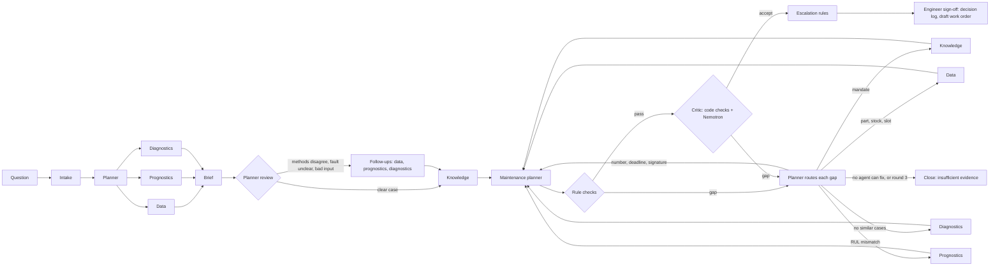

# Cleris

The MRO clearance assistant. An evidence-backed maintenance decision agent for turbofan engines. Open Agent Hackathon 2026, track "The Agent That Can Explain Why". Design notes: `AGENTS.md`.

It answers: **what is wrong with this engine, how long do I have, and what should I do?** Every number is computed in Python or SQL and stored as evidence. Claims without a resolvable evidence ID fail the rule checks.

**Why it matters, in practitioners' words** (short excerpts, verified at source on 26 Oct 2026):

- Japan Airlines' VP of IT and digital promotion, Sugimoto Kei: "a big challenge for us is really our data and it's very disparate." ([Constellation Research](https://constellationr.com/insights/news/how-aviation-maintenance-looks-ai-systems), Oct 2026)
- Sarunas Kisevicius, EngineStands.com: "spare engine pools have become much thinner" as engines spend longer in overhaul. ([Aviation Week](https://aviationweek.com/mro/supply-chain/tightening-parts-supply-intensifies-airlines-summer-aog-pressures), 14 Jul 2026)
- Alice Belcher, Delta TechOps, on predictive alerts: "The analytic itself does not make maintenance decisions." Engineers investigate and decide. ([Aviation Week](https://aviationweek.com/mro/emerging-technologies/false-alerts-test-trust-predictive-maintenance-systems), 19 Oct 2026)

All maintenance, spares and document data in this project is **synthetic**. Telemetry is the NASA C-MAPSS simulated dataset (FD001 / FD003).

> **Hackathon prototype.** Runs on NASA C-MAPSS simulated telemetry and synthetic maintenance, spares and document data. Not certified or approved by any aviation authority and not for operational use. It does not issue a return to service or a certificate of release to service: approval drafts a work order for the organisation's own release process.
>
> **Intended use:** advisory decision support for the engineer. Never the sole source of an airworthiness determination or a change to maintenance intervals. "Clearance" in the product line means the engineer's decision to keep, inspect or remove an engine; the release to service stays with certifying staff in the organisation's own system. See [`docs/regulatory-requirements.md`](docs/regulatory-requirements.md).

**Judges / clean clone:** set `SAMPLE_MODE=true` and run. That path uses only committed Parquet snapshots and SQLite case memory. It does not need Zetaris, Nightshift, Docker, Node, or any credentials. If a live service is down during judging, the same snapshot path is used automatically and the brief is flagged `degraded`.

```powershell
uv sync
$env:SAMPLE_MODE = "true"
uv run python run.py --question "What should I do about FD001-A031?"
# or: docker build -t cleris . ; docker run --rm -p 8000:8000 cleris
# then: curl http://127.0.0.1:8000/health
#       curl -X POST http://127.0.0.1:8000/run -H "Content-Type: application/json" --data-binary @input_examples/critical_hpc.json
```

macOS / Linux:

```bash
uv sync
SAMPLE_MODE=true uv run python run.py --question "What should I do about FD001-A031?"
SAMPLE_MODE=true uv run task ui        # decision brief UI on http://localhost:8501
```

No `.env.local` or other credentials are needed: `.env*` files are git-ignored (only `.env.example` with placeholders is committed) and excluded from the Docker image. Checked on 26 Oct 2026 from a fresh clone with no credentials: CLI, `POST /run`, the test suite, `docker build` / `docker run` and the UI all ran in sample mode. Without `SAMPLE_MODE`, a run still completes on the snapshot and the brief is flagged `degraded` ("LLM critic unavailable").

## Prerequisites

- Python 3.11 and [uv](https://docs.astral.sh/uv/)
- Node.js 24 LTS (Meterless context service; not needed for `SAMPLE_MODE`)
- Nightshift desktop app (Meterless runtime on port 8088; not needed for `SAMPLE_MODE`)
- Docker Desktop (optional; local Postgres for tests)

## Setup

```powershell
uv sync
```

Sample mode needs no environment file. For live mode, copy `.env.example` to `.env.local` and replace the empty placeholders. `.env.example` has names only; `.env.local` is gitignored. The names are the fields of `Settings` in `settings.py`. The NVIDIA key stays in Nightshift's Providers tab.

## Sample mode (no credentials, no network)

```powershell
$env:SAMPLE_MODE = "true"
uv run python run.py --question "How long can FD003-A100 keep flying and what is wrong with it?"
```

This uses the committed Parquet extracts in `data/snapshot/` and a local SQLite case memory. It does not call Zetaris, Nightshift or the internet. Sample inputs and outputs: `input_examples/`, `output_examples/`.

`uv run python run.py --serve` exposes `POST /run` with JSON `{"question": "..."}` and structured errors.

```powershell
$env:SAMPLE_MODE = "true"
uv run task ui
```

Opens the decision brief at http://127.0.0.1:8501 (laid out for desktop and tablet). Approve drafts a work order to `.state/draft_work_orders.jsonl` in sample mode; live mode with `PG_APP_USER` inserts into `cmms.work_orders`.

What a reviewer can check in the UI, without reading code:

- **How the brief was checked**: chips under the verdict give the rule-check result, critic rounds and the model that answered. The Trace tab shows every step as a timeline.
- **Why this plan and not another**: each rule the planner applied (severity band, swap against parts lead time plus the first free slot, method disagreement, mandates), this engine's value, and the value at which the plan would change. Computed from the planner's decision record and the asset pack thresholds.
- **Stress test**: inject any of the 16 seeded mistakes (tampered remaining life, fabricated part, dropped mandate, and others) into the brief on screen and see which gate stops it. The same faults and gates as the evaluation.
- **Fleet triage**: "Which engines need attention this week?" is answered from `data/snapshot/fleet_triage.parquet`, which `uv run task fleet-triage` builds by running the full agent graph on all 200 active engines (sample mode, about 75 s). The Fleet tab shows when it was computed and can recompute it.

## Agents and how they coordinate

Not a fixed pipeline: the planner delegates follow-ups when the findings call for them, and every gap a gate finds goes to the agent that can fix it.



| Agent or gate | Does | Uses a model? | Can block or send back? |
| --- | --- | --- | --- |
| Intake | Resolves the engine; parser first | Nemotron only for free text; code checks the quote and the registry | Asks back when no engine is found |
| Planner | Assigns the specialists, reviews their findings and delegates follow-ups, routes each gap to its owner | No | Routes; closes a case no agent can fix |
| Data | Telemetry, history, stock, slots through Zetaris; input plausibility gate | No | Raises a data-quality escalation |
| Prognostics | RUL A (LightGBM quantiles, calibrated) and RUL B (health-index trend), SHAP drivers, back-test at the last inspection | No | No |
| Diagnostics | Fault mode, discriminating sensors, similar past cases from H-MEM | No | No |
| Knowledge | Documents in effect, in precedence order; mandates decided in code | No | Mandate escalation |
| Maintenance planner | Task from the World Model, parts, slot, deadline, every claim with evidence | No | No |
| Rule checks | Deterministic checks on every claim and number | No | Sends back |
| Critic | Deterministic checks, then Nemotron tries to disprove the brief; code verifies each challenge | Nemotron (live; recorded replies in sample mode) | Sends back only on a challenge code confirms |
| Escalation rules | Fixed rules from the asset pack | No | Escalates |
| Engineer | Approves or rejects with name, acknowledgements and a reason for urgent escalations | Human | Decides |

**Follow-ups.** After round 1 the planner checks the findings. If the two remaining-life methods disagree beyond the pack's limit, the Data agent pulls the inspection history and prognostics back-tests both methods at the last inspection. If the fault mode is unclear, diagnostics reads the discriminating sensors and past cases for both candidates. If the input failed a plausibility check, the Data agent re-reads it. Follow-ups only make the plan more cautious, and a clear case logs "no follow-up needed" with the reason. Routing table: `assurance/routing.py`.

**Nemotron in sample mode.** Judges usually run without Nightshift, so sample mode replays Nemotron replies captured from live calls on 26 Oct 2026 (`data/snapshot/llm_recordings.json`, model `nvidia/nemotron-3-ultra-550b-a55b`). A reply is used only when the prompt hash matches exactly; code verifies every replayed challenge as in live mode, and the trace, decision log and brief label it "recorded Nemotron response". A changed prompt falls back to the deterministic checks, and a test fails if the golden prompts drift (`uv run task record-llm` re-captures).

**Decision log and sign-off.** Every agent, gate, model and human decision is recorded in order (Details, Decision log tab; `casefile/decision_log.py`). To approve, the engineer types a name (role and licence reference optional), ticks each escalation as read and gives a reason for urgent ones; the entry binds to the brief by a SHA-256 of the recommendation. The log is stored append-only with a SHA-256 hash chain under `.state/decision_logs/` and attached to the draft work order, which says it is not a certificate of release to service.

**Help for non-experts.** A Help button and "What is this?" links open one panel: what each part of the screen means for the open engine, a searchable glossary of 105 terms and abbreviations, an engine diagram with the sensors and fault modes, credited photos, and "Ask Cleris": Nemotron explains the brief from the fields on screen, and code flags any number in its answer that the brief does not contain.

## Documents (Knowledge agent)

`asset_packs/turbofan_cmapss/docs/` holds five SYNTHETIC documents: maintenance manual revision 3, a superseded revision 2, two service bulletins and an airworthiness directive. Each section is one chunk with metadata (document type, revision, effective date, fleet variant, components, failure modes, FMEA tasks, optional topic and mandate).

The Knowledge agent runs after the specialists, because what applies depends on their fault mode and remaining-life lower bound. It:

1. reads the chunks for the asset type (Zetaris `knowledge_pg.doc_chunks` live, `doc_chunks.parquet` in sample mode);
2. keeps revisions in effect on the reference date, for the fleet variant and the suspected components;
3. ranks them by cosine similarity to a query built from the findings, keeping the top 4;
4. orders them by precedence (airworthiness directive > service bulletin > manual > procedure) and marks a lower document overridden when a higher one covers the same topic;
5. decides in code whether a mandate's conditions hold (fault-mode probability, RUL lower bound).

A mandate that applies is listed first among the escalations. The maintenance planner must include its FMEA task and deadline, and a rule check sends the plan back if the task is missing, uncited or deferred. Embeddings are hashed word uni- and bigrams (scikit-learn `HashingVectorizer`, 512 dimensions), so sample mode retrieves exactly like live mode with no model download.

## Golden cases

| Engine | Question in the UI | What should happen |
| --- | --- | --- |
| FD001-A001 | Healthy | RUL at the cap, no wear; continue in service, no similar cases searched |
| FD001-A031 | HPC swap | HPC degradation, RUL lower bound shorter than short-part lead time plus next free slot: lease-engine swap, airworthiness directive task kept in the plan |
| FD003-A100 | Fan swap | Fan degradation; the critic sends round 1 back because the SHAP drivers are common-trend sensors, round 2 names the distinguishing sensors |
| FD001-A070 | Methods disagree | RUL A 96 vs B 40 cycles: escalation `rul_divergence`, borescope inspection, confidence low, deadline from the cautious bound |

Inputs and outputs: `input_examples/*.json`, `output_examples/*.json`.

## Assurance

Advisory agents propose; the gates can only send work back or stop it.

0. **Input plausibility** (`tools/data_quality.py`, run by the Data agent before any model output is used, no LLM): telemetry outside the range seen on any C-MAPSS engine (plus a margin), jumps between cycles larger than any engine showed, a model sensor frozen for 30 cycles, missing values, duplicate, backward or missing cycles, telemetry ending at a different cycle from the asset registry, future timestamps, work orders after the last cycle, a removal recorded on an active engine, negative stock or lead time. Limits are in the asset pack (`data_quality` in `manifest.yaml`, ranges in `sensor_ranges.json` built by `uv run task sensor-ranges`). A serious issue (anything a model reads, or the stock) sets confidence low, puts "Confirm the input data first" in front of the action and raises a `data_quality` escalation; a minor one (a sensor the models ignore, a gap, a stray date) is flagged in the brief. Impossible stock counts as none available.
1. **Rule checks** (`assurance/rules.py`, no LLM): every claim cites evidence IDs that resolve; RUL values in 0..125 with the estimate inside its interval; RUL and fault-mode numbers equal the model output they cite; asset matches the question; every part is listed in the evidence it cites, with the same stock and lead time; the slot is in the free-slot list; the deadline is not later than the RUL lower bound allows; mandated document tasks are present, cited and on time; every task is on the World Model's list for the fault; every number a claim states is in its cited evidence (or a pack threshold, a sum or difference of two headline values, or a cycles-to-days conversion). On the 200-engine fleet, 0 of 2,907 clean claims fail the number check.
2. **Evidence critic** (`agents/critic.py`): deterministic checks always run (SHAP drivers must not be passed off as the fault-mode signature; a degraded engine needs similar past cases). When Nightshift is up and `SAMPLE_MODE` is off, Nemotron tries to disprove the brief. Its free-text gaps are shown to the engineer. Its checkable challenges (`assurance/challenges.py`: unsupported number, missing mandate, part not in evidence, deadline after the bound, wrong engine) are verified by code: a confirmed challenge sends the brief back, a refuted one is shown as refuted. It never produces a number. Max 3 rounds; round 3 without acceptance closes the case as `insufficient_evidence`.
3. **Escalation rules** (`assurance/escalation.py`, thresholds from the asset pack): input data failed a serious plausibility check; RUL lower bound shorter than short-part lead time plus next free slot; RUL A vs B differ by more than 20 cycles; two fault modes within 0.15; an applicable document mandates an action.
4. **Engineer sign-off** in the UI. Nothing is written before Approve.

The LLM critic runs as its own Nightshift app (`METERLESS_CRITIC_APP=turbofan-maintenance-critic`, sent as the `meterless-app` header) so Nightshift can pin it to a Nemotron lane whatever `meterless/auto` would pick for other apps. In Nightshift, give that app a Judge lane with an NVIDIA Nemotron model. The trace records the model that actually answered and notes `critic lane not pinned to Nemotron` when Claude or GPT answered.

## Reliability and fallbacks

| Failure | What the run does | What the brief says |
| --- | --- | --- |
| Zetaris down or not configured | Snapshot for the rest of the run | `Zetaris unavailable (...)` / `Zetaris not configured`; every later evidence record flagged `degraded` |
| Zetaris slow | Each query times out after `ZETARIS_TIMEOUT_S` (10 s, 3 attempts); after `ZETARIS_BUDGET_S` (30 s) of live query time the run switches to the snapshot | `Zetaris slow (N s of the 30 s query budget used)` |
| Context service (Meterless) down | SQLite case memory | `context-service unreachable ...; using SQLite` |
| Nightshift down, critic timeout (`CRITIC_TIMEOUT_S`, 45 s) or a non-JSON critic reply | Deterministic critic checks only; the run still completes | `LLM critic unavailable (...); deterministic critic checks only` |

Hard limits: 3 critic rounds, 25 graph steps, 120 s per run. If the LLM critic would exceed the remaining run time, it is skipped and the deterministic checks still finish the brief. `tests/test_fallbacks.py` runs each failure end to end offline.

## Case memory feedback

When the engineer approves or rejects, the decision is stored in case memory (H-MEM, or SQLite when the context service is down). Every similar past case the brief cited also gets feedback: helpful on approve and not helpful on reject, unless the engineer marks it helpful, not helpful or wrong in the sign-off form. Trust moves by +0.05, -0.03 or -0.20 (wrong also tags the case for review), and the next similar-case search ranks by relevance times trust. The brief shows each case's trust before and after.

## Evaluation

```powershell
uv run task download   # once: NASA answer key into data/raw/ (eval only; agents never read it)
uv run task eval       # 200 active engines in sample mode, about 1 minute
```

Writes `evaluation/report.md` and `report.json`. Results from the committed snapshot:

- **Decisions against what happened:** of the 45 engines that fail within 15 days (NASA answer key), 45 were sent for removal, swap or repair and none was told to keep flying. Of the 102 with more than 40 days left, 60 keep flying, 41 get an inspection and 1 is pulled early. Of the 53 in between, 1 is told to keep flying.
- **Completion:** 200 of 200 runs reach `needs_review`, median 0.3 s per run.
- **Remaining life:** RUL A RMSE 12.1; its 10th–90th range covers 80% of true values (nominal 80%) after calibration on the held-out engines (`uv run task calibrate-rul`: conformalised quantile regression, one margin per side; the lower bound moves 1.8 cycles, coverage was 73%). RUL B RMSE 22.3, but 7.6 when true RUL is 25 cycles or less.
- **Safety of the planning bound:** at or below the true RUL for 92% of engines (90% before calibration). Of the 45 engines within 15 days of failure, 1 overshoots. The remaining overshoots are mostly on engines with plenty of life left.
- **Disagreement flag:** 54 engines (27%); RUL A error there is 11.6 vs 7.5 elsewhere.
- **Fault mode (FD003):** 97% agreement with the proxy label; 100% within 60 cycles of failure.
- **Evidence:** 2,907 claims, all with resolvable evidence; every claim that states a quantity cites model, query, rule or case-memory evidence.
- **Seeded faulty briefs:** 16 fault types (uncited claim, tampered or averaged RUL, fabricated part, inflated stock, slot not free, deadline past the RUL bound, mandate dropped, a changed number in a supporting claim, and others) applied to 30 finished briefs: 311 of 311 caught by the deterministic gates, 0 false alarms on the clean briefs. The first version of the gates missed the tampered RUL, fabricated part and inflated stock faults; the eval found them and two rule checks were added. The changed-number fault got through until the number check was added on 25 Oct; building that check also found a claim citing the wrong evidence, now fixed.
- **Nemotron on its own** (`uv run task eval-llm`, needs Nightshift; `evaluation/llm_critic_report.md`): the four golden briefs, corrupted with every fault that applies, go to the Nemotron critic with the deterministic gates bypassed. It flagged a problem in free text on 34 of 41; code confirmed 3 of its 150 checkable challenges and refuted 147; it blocked no clean brief. That is why code, not the model, decides.
- **Implausible input data:** 0 of the 200 clean runs raise a data-quality issue. 12 corruptions (a T30 spike, P30 in kPa instead of psia, a frozen Ps30, missing phi readings, duplicate, reversed and truncated cycles, a removal on an active engine, negative stock as serious; a cycle gap, an out-of-range T2 the models ignore and a work order after the last cycle as minor) fed through the full graph on 10 engines: 116 of 116 graded at the expected severity, no crashes. Building these found two crashes, now fixed: missing readings broke the telemetry summary, and two specialists failing in the same step broke the graph state.

## Research findings

`docs/research-findings.md` (26 Oct 2026) lists the market and regulatory findings that point to changes in Cleris, each with its sources and its status here (built, partly built, not built). `docs/regulatory-requirements.md` maps EASA, FAA, ICAO and industry requirements for an operator using a tool like Cleris: 26 requirements, 2 met, 15 partly met, 9 not met, with the actions for a pilot and for operational use. The items with the most weight:

- **Sign-off:** a return to service is signed by a certificated person (14 CFR 43.9; EASA Part-145.A.50), but the Approve record names no signer. Record who decided, and leave the release with certifying staff.
- **Wording:** "clearance" and "release" are regulated words, and the repo has no "not for operational use" statement.
- **Uncertainty and cost:** weight RUL A's range against late removal (asymmetric conformal intervals), and set the inspect and remove thresholds from what each kind of false alarm costs.
- **Data:** read a real M&E system through mapped connectors; today the SQL names the team's own synthetic tables.

## Live mode

The Zetaris cluster, the Postgres databases (AWS RDS) and the S3 bucket stay up in the cloud through judging (28 Oct–6 Nov). Live mode needs credentials, which are not in this repo; sample mode needs none.

1. Start Nightshift. Put the Console runtime token in `METERLESS_RUNTIME_TOKEN`. Add provider keys (including NVIDIA) in Nightshift **Setup → Providers**, not in this repo. After the first live run, the app `turbofan-maintenance-critic` appears in Nightshift; give it a Judge lane with a Nemotron model.
2. Start the context service: `uv run task context-service` (port 8710). Load once with `uv run task load-context` (idempotent).
3. Set `SAMPLE_MODE=false` and `ZETARIS_MODE=live` in `.env.local`.
4. `uv run python run.py --question "..."` — Zetaris is queried first; on failure the run switches to the snapshot and every later evidence record is flagged `degraded`.

`uv run task check-llm` confirms Nightshift. `uv run task check` confirms RDS and Zetaris. Before recording a demo, `uv run task preflight` checks every live dependency (mode, Zetaris, context service, the Nemotron critic lane) and runs one live brief; it writes nothing.

## Commands

| Command | What it does |
| --- | --- |
| `uv run task test` | Unit tests |
| `uv run task eval` | Fleet evaluation, decisions against the answer key, seeded faulty briefs and corrupted inputs (`evaluation/report.md`) |
| `uv run task fleet-triage` | Run the agent graph on all active engines and rank them by decision and deadline (`data/snapshot/fleet_triage.parquet`) |
| `uv run task eval-llm` | Nemotron critic on its own against the seeded faults (needs Nightshift; `evaluation/llm_critic_report.md`) |
| `uv run task preflight` | Read-only check of every live dependency plus one live brief, before recording a demo |
| `uv run task calibrate-rul` | Calibrate RUL A's 10th–90th range on the held-out engines (stored in `rul_a.json`) |
| `uv run task sensor-ranges` | Plausible sensor ranges and steps from the training engines (`asset_packs/.../sensor_ranges.json`) |
| `uv run python run.py --question "..."` | One decision brief as JSON |
| `uv run task ui` | Streamlit decision brief (approve / reject, fleet, trace, asset pack) |
| `uv run python run.py --serve` | `POST /run` on `RUN_HOST:RUN_PORT` (`GET /health` included) |
| `docker build -t cleris .` then `docker run --rm -p 8000:8000 cleris` | Sample-mode API, no credentials |
| `uv run task check` | Read-only connectivity check (live credentials) |
| `uv run task check-llm` | Nightshift `GET /v1/models` plus one chat request |
| `uv run task context-service` | Meterless World Model + H-MEM on 127.0.0.1:8710 |
| `uv run task load-context` | Load asset pack + 200 past cases into the context store |
| `uv run task snapshot` | Rebuild `data/snapshot/*.parquet` (`--verify` compares with Zetaris) |
| `uv run task ingest-docs` | Chunk and embed the asset pack's documents into `knowledge.doc_chunks` (pgvector) and `data/snapshot/doc_chunks.parquet` (`--target none` for the snapshot only) |
| `uv run task train-rul` | Remaining-life methods A (LightGBM) and B (health-index trend) |
| `uv run task train-fault-mode` | Calibrate the signature matcher |
| `uv run task train-anomaly` | Fleet health-index curve for the anomaly flag |
| `uv run task download` | NASA C-MAPSS FD001/FD003 into `data/raw/` (not committed) |

## Sponsor tech

- **Zetaris:** all structured reads go through the AI Data Gateway REST SQL API (`tools/zetaris.py`), guarded to `SELECT` only. Snapshot fallback when it is down.
- **Meterless:** (1) Nightshift is the only model provider (`tools/llm.py`): free-text intake and the evidence critic, both checked by code. (2) The World Model holds the asset graph; the maintenance planner reads which tasks address the fault mode. (3) H-MEM holds past removals. Diagnostics cites similar cases and the median warning those cases gave; the engineer's approve/reject updates their trust. Both engines run in `context-service/`. SQLite is the fallback when that service is down.
- **NVIDIA:** one Nightshift app whose lane is pinned to an NVIDIA Nemotron model (the NVIDIA key lives in Nightshift Providers, not in this app) does two jobs. (1) Free-text intake: when the parser finds no engine ("the engine with serial 700131", "engine thirty-one of the first fleet"), Nemotron names it and quotes the words; code accepts it only if the quote is in the question, contains the engine's number, and the engine is in the registry (`agents/intake.py`). (2) The critic, whose checkable challenges change the outcome only when code confirms them. The planner is code. The lane runs **Nemotron 3 Ultra 550B A55B** (`nvidia/nemotron-3-ultra-550b-a55b`); on the four golden cases it answered in 6–37 s and the trace records it as the critic model. Other hosted Nemotron models did not work for this account on 23 Oct (empty responses, the 45 s Nightshift provider limit, not entitled, or retired). If the critic does not answer, the deterministic checks carry the verdict and the brief says `LLM critic unavailable`.
- **Cursor:** this repository was developed in Cursor. Claude Code was also used from 25 Oct for fixes, verification and the release (handoff notes in `CLAUDE.md`).

## Pre-existing components

- NASA C-MAPSS FD001/FD003 (simulated turbofan run-to-failure). Not committed; `uv run task download`.
- Meterless H-MEM and World Model reference engines, vendored at commit `1742dec` under Apache License 2.0. See `context-service/vendor/VENDORED.md`.
- Failure physics follow Saxena, Goebel, Simon, Eklund (2008). The FMEA table and all CMMS / planning data are generated and labelled synthetic.
- Photos in `asset_packs/turbofan_cmapss/images/` are from Wikimedia Commons, used unmodified under their licences (public domain, CC BY 2.0, CC BY-SA 2.0/3.0). Author, licence and source page for each are listed under `images` in `manifest.yaml` and shown under each photo in the UI. They illustrate the engine class (mostly CFM56), not the simulated units. The engine diagram is drawn from the asset pack's `diagram` section.

## Traces

Each run writes `logs/trace-<run_id>.jsonl` (timestamp, run_id, agent_name, action, input_summary, output_summary, target_agent, model, confidence, retry_count, status). The served model name is logged for every LLM request.

Committed examples in `trace_examples/`:
- `trace-sample-*`: the four golden cases in sample mode, plus FD001-A031 with a corrupted T30 reading (serious: `data_quality` escalation, confidence low) and with a gap in the cycles (minor: flagged only). The four golden traces were regenerated on 25 Oct; the two corrupted-input traces are from 23 Oct, before the World Model eligibility work. Degraded engines include the World Model task lookup and the H-MEM median warning.
- `trace-live-critic-*`: the four golden cases in live mode (25 Oct): data read through Zetaris, the World Model and H-MEM from the context service, and the LLM critic answered through Nightshift by Nemotron 3 Ultra 550B (`model` on the critic line). Each run took 6–14 s. On FD003-A100 round 1 is the deterministic driver check and round 2 is the Nemotron pass.
